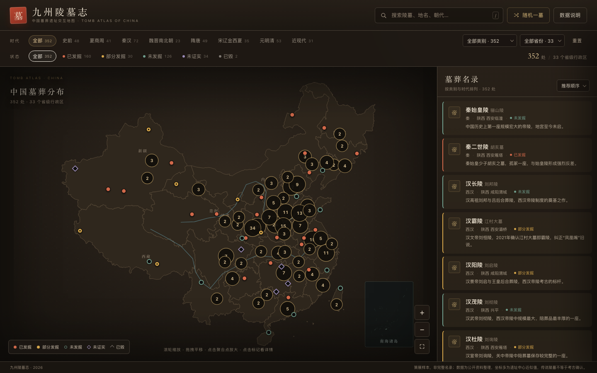
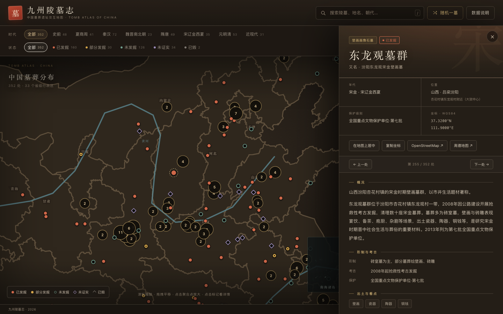
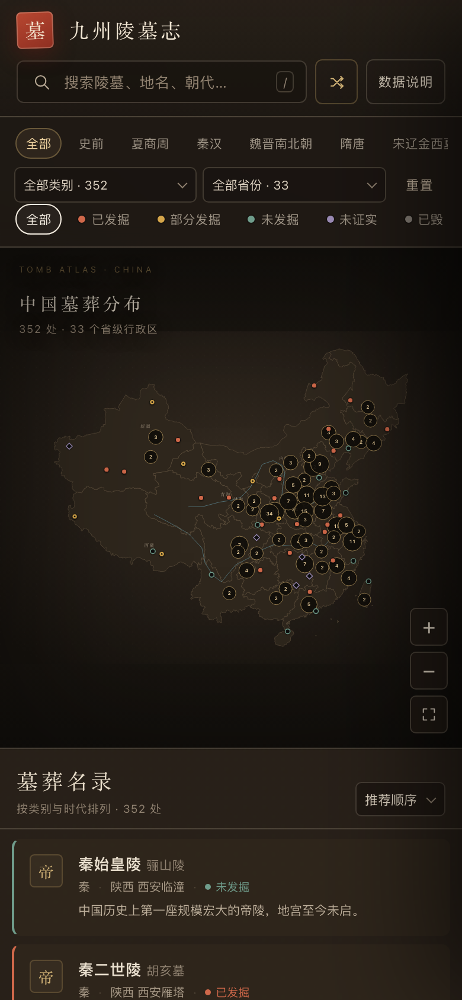

# 九州陵墓志 · 中国墓葬遗址交互地图

一张可以探索的中国墓葬地图：把帝王陵寝、王侯贵族墓、将相名臣墓、文人墓、史前墓地、壁画墓、崖墓悬棺、边疆民族墓、传说陵墓与近现代陵园放在同一张地图上，标注位置、年代、发掘状态、保护级别与考古故事。

> **在线访问**：<https://liaun.github.io/tomb-atlas/>
>
> **先说清楚**：这不是“中国全部已知墓葬”的完整名录。中国已知的古代墓葬以万计，一张网页无法、也不应该假装收全。当前版本收录 **352 处代表性墓葬与墓群**，覆盖 **33 个省级行政区**，重点在“有明确的墓主/遗址位置/考古意义/公众认知度”的条目，并保留了一批传说陵墓与争议墓葬。数据可以按同一格式继续扩充。



## 功能

- **一张可缩放的中国地图**：本地 SVG 省界底图，Albers 等积投影，不依赖在线地图服务。
- **352 处墓葬**：按 10 个类别、8 个时代、5 种发掘状态分类；已发掘 160、未发掘 126、部分发掘 30、未证实 34、已毁 2。
- **地图交互**：滚轮/双指缩放、拖拽平移、点击聚类放大、点击标记查看详情、随机一墓。
- **筛选与搜索**：时代、状态、类别、省份多条件组合；支持名称、别名、地名、朝代、出土物、标签全文检索。
- **详情页**：年代、位置、保护级别、坐标、形制、考古经过、出土看点、争议与未解、相近墓葬、外部检索与地图链接。
- **连续浏览**：详情页「上一处 / 下一处」按钮，桌面端支持键盘 ← → 切换。
- **深链接**：`index.html#tomb=qin-shihuang` 直接打开秦始皇陵；`index.html#about` 打开数据说明。
- **暖色视觉**：深色底图整体提亮，正文与地图对比度更高，减少长时间浏览的压迫感。
- **响应式**：桌面三栏（地图 + 名录 + 详情抽屉），手机单栏（地图 + 名录 + 全屏详情）。
- **完全离线**：无 CDN、无外部字体、无网络请求，直接打开 `index.html` 即可。





## 快速开始

### 方式一：直接打开

双击 `index.html`。所有脚本、样式和地图数据都在本地，`file://` 下可以正常使用。

### 方式二：本地静态服务器（推荐）

在项目目录执行：

```bash
python3 -m http.server 8000
```

然后访问 `http://localhost:8000/`。

## 目录结构

```
tomb-atlas/
├── index.html                 页面结构
├── assets/
│   ├── style.css              视觉样式与响应式布局
│   ├── app.js                 地图、筛选、名录、详情、路由
│   ├── tombs.js               由 data/*.json 生成的运行时数据
│   └── china-map.js           由 tools/build_map.py 生成的省界/投影数据
├── data/
│   ├── 01-imperial-a.json     秦—隋帝陵
│   ├── 01-imperial-b.json     唐—南宋帝陵
│   ├── 01-imperial-c.json     辽金西夏—清帝陵
│   ├── 02-royal-a.json        商周—春秋王侯墓
│   ├── 02-royal-b.json        秦汉—明王侯墓
│   ├── 03-officials.json      将相名臣
│   ├── 04-literati.json       文人名士
│   ├── 05-prehistoric.json    史前墓地
│   ├── 06-mural.json          壁画/画像石墓
│   ├── 07-cliff.json          崖墓悬棺
│   ├── 08-frontier.json       边疆民族
│   ├── 09-legend.json         传说/纪念陵
│   ├── 10-modern.json         近现代陵园
│   ├── 11-imperial-royal.json 秦汉—明帝陵/王侯补遗
│   ├── 12-prehistory-mural-cliff.json 史前/壁画/崖墓补遗
│   ├── 13-people-modern.json  名臣/文人/近现代补遗
│   ├── 14-frontier-legend.json 边疆/传说补遗
│   ├── 15-additions.json      宋金辽壁画、后周/南汉/明藩王等补遗
│   └── 16-more.json           东汉/北朝帝陵、明藩王、名人墓补遗
├── screenshots/               预览图
└── tools/
    ├── build_data.py          校验 JSON 并生成 assets/tombs.js
    ├── build_map.py           从 DataV GeoJSON 生成 assets/china-map.js
    └── china_raw.json         省界原始数据（约 570 KB）
```

## 数据说明

### 收录口径

- **帝王陵寝**：从秦始皇陵到清东陵、清西陵，含未发掘、已发掘与已毁的帝陵。
- **王侯陵墓**：商周方国、曾国、中山国、楚国、汉代诸侯王、南越王、高句丽王陵、藏王墓等。
- **将相名臣 / 文人名士**：霍去病、诸葛亮、岳飞、孔子、李白、杜甫、苏轼等。
- **史前墓地**：山顶洞、半坡、贾湖、良渚、陶寺、二里头、石峁、三星堆等。
- **壁画画像石墓 / 崖墓悬棺 / 边疆民族**：武氏祠、娄睿墓、章怀太子墓、珙县悬棺、楼兰、尼雅、播州土司墓等。
- **传说纪念 / 近现代陵园**：黄帝陵、炎帝陵、成吉思汗陵、中山陵、鲁迅墓、胡适墓、蔡元培墓等。

### 状态定义

| 状态 | 含义 |
| --- | --- |
| 已发掘 | 墓室经过考古发掘或清理，出土材料已发表 |
| 部分发掘 | 陵园、陪葬坑或部分墓室经过发掘，主墓室可能尚未开启 |
| 未发掘 | 墓位基本明确，但主墓室尚未进行考古发掘 |
| 未证实 | 墓主、墓位或性质存在争议，或属于传说陵墓、衣冠冢 |
| 已毁 | 地面建筑或墓室已毁，仅存遗址、封土或石刻 |

### 完整度与缺口

当前 **352 处是策展样本，不是完整名录**。即使只算全国重点文物保护单位中的“古墓葬”，也还有大量未收；省保、县保和普通墓地更未系统覆盖。当前缺口尤其集中在：宋金砖雕壁画墓、地方性国保、边疆小型墓地、近现代名人墓。

东龙观墓群（山西汾阳，第七批国保，宋金壁画墓）就是读者指出后补入的例子。后续扩充应优先按《全国重点文物保护单位》古墓葬类逐批补录，再补各省省保，而不是继续按“名气”挑选。

### 坐标精度

- 坐标为 **WGS84**，多数取遗址/封土中心，精度从“数十米”到“数公里”不等。
- 详情页的“位置说明”会标注坐标所指的位置（封土中心、陵园入口、纪念地、候选地等）。
- 传说陵墓与衣冠冢只能标在纪念地或候选地，**不能视作考古确认的墓位**。
- 地图底图为省界示意，不用于边界主张或精确测量。

### 数据来源

整理时参考了：

- 国家文物局公布的全国重点文物保护单位名录与相关公告；
- “全国十大考古新发现”历年名单与考古简报；
- 各省文物局、考古研究所、博物馆的公开资料；
- UNESCO 世界遗产名录；
- 公开出版的考古报告、通史与辞书条目。

条目由 AI 辅助编纂，可能存在年代、墓主、保护级别或坐标误差。**欢迎以正式考古报告与官方公告为准**；若发现错误，直接修改 `data/*.json` 后重新生成即可。

### 重要提醒

- “未证实”不等于“假”；它表示现有证据不足以确认墓主或墓位。
- 请勿擅自进入未开放区域、攀爬封土、挖掘或进行“探墓”直播。
- 中国《文物保护法》禁止盗掘、破坏文物。参观前请确认开放信息，遵守现场规定。

## 如何扩充数据

### 1. 修改或新增条目

在 `data/` 下选择对应类别的 JSON 文件，新增一个对象。字段如下：

| 字段 | 类型 | 说明 |
| --- | --- | --- |
| `id` | string | 唯一英文/拼音标识，用于 URL |
| `name` | string | 名称 |
| `alias` | string | 别名，可为空 |
| `cat` | enum | 类别（见下） |
| `status` | enum | 状态（见上表） |
| `dynasty` | string | 朝代/文化，如“西汉”“战国”“良渚文化” |
| `era` | enum | 时代分组（见下） |
| `province` | string | 省级行政区简称，如“陕西”“内蒙古”“台湾” |
| `city` | string | 市/区/县方位 |
| `lat` / `lng` | number | WGS84 纬度/经度 |
| `coordNote` | string | 坐标所指位置说明 |
| `level` | string | 保护级别，可为空 |
| `excavation` | string | 考古/营建经过 |
| `structure` | string | 形制、陵园布局 |
| `finds` | string[] | 出土物/看点 |
| `summary` | string | 一句话简介 |
| `detail` | string | 2—4 句详细说明 |
| `dispute` | string | 争议与未解，可为空 |
| `tags` | string[] | 标签，如“世界文化遗产” |

类别：`帝王陵寝`、`王侯陵墓`、`将相名臣`、`文人名士`、`史前墓地`、`壁画画像石墓`、`崖墓悬棺`、`边疆民族`、`传说纪念`、`近现代陵园`。

时代：`史前`、`夏商周`、`秦汉`、`魏晋南北朝`、`隋唐`、`宋辽金西夏`、`元明清`、`近现代`。

### 2. 重新生成并校验

```bash
python3 tools/build_data.py
```

脚本会：

- 检查 JSON 语法、必填字段、枚举值、经纬度范围；
- 检查 `id` 是否重复；
- 用省界多边形检查坐标是否落在所填省份（不匹配会给出警告）；
- 生成 `assets/tombs.js`，页面刷新即可看到新数据。

### 3. 修改底图（可选）

```bash
python3 tools/build_map.py
```

需要 `tools/china_raw.json`（DataV GeoAtlas 省界数据）。脚本会做 Douglas-Peucker 简化、Albers 投影，并生成 `assets/china-map.js`。

## 技术说明

- 纯原生 HTML / CSS / JavaScript，无框架、无构建步骤、无外部请求。
- 地图用 SVG 绘制，省界来自 DataV GeoAtlas；投影为 Albers 等积圆锥投影（标准纬线 25°N / 47°N，中央经线 105°E）。
- 标记使用网格聚合；选中墓葬时单独绘制，避免被聚合点遮住。
- 详情抽屉、筛选、搜索、随机、URL hash 路由全部在前端完成。
- 推荐使用较新的 Chrome、Edge、Safari 或 Firefox。

## 版本

- v1.3 · 2026-10
- 当前收录：352 处 / 33 个省级行政区 / 10 个类别
- 底图：DataV GeoAtlas（仅用于省界示意）

## 更新记录

- **v1.3（2026-10）**：新增 28 处，包括东汉帝陵、孟知祥墓、后周顺陵、东魏/北齐帝陵、梳妆楼元墓、明秦/晋/周藩王陵、清昭西陵/慕陵、管仲/晏婴/狄仁杰/郭子仪/刘基/李鸿章墓、北辛/大溪/昂昂溪/圆山/卑南遗址、霍元甲墓；总数 352，覆盖 33 个省级行政区。
- **v1.2（2026-10）**：补入白沙宋墓、叶茂台辽墓、陈国公主墓、南汉二陵、后周皇陵、明景泰陵、明靖江/鲁/楚王陵等 22 处；总数 324；整体提亮为暖色“灯火”主题。
- **v1.1.1（2026-10）**：补入山西汾阳东龙观墓群（第七批国保，宋金壁画墓），总数 302；在数据说明中明确“策展样本、非完整名录”的缺口。
- **v1.1（2026-10）**：从 181 处扩充到 301 处；新增 30 处帝陵/王侯墓、30 处史前/壁画/崖墓、30 处名臣/文人/近现代墓、30 处边疆/传说陵墓；新增详情页连续浏览、Open Graph 分享信息与 sitemap。
- **v1.0（2026-10）**：首次发布，181 处墓葬，GitHub Pages 上线。

## 在线部署

本项目的 GitHub Pages 从 `main` 分支根目录发布，地址为 <https://liaun.github.io/tomb-atlas/>。仓库中的 `.nojekyll` 用于跳过 Jekyll 处理，保证 `assets/` 等目录按原样提供。

## 使用与授权

本项目用于学习、研究与个人浏览。代码与整理后的数据可自由修改用于非商业用途；地图底图版权归原数据提供方所有。引用考古资料时请注明原始报告与官方来源。
